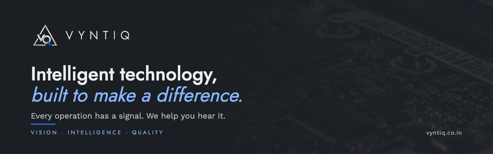

  

  
  
  

### Intelligent by design. Practical by purpose.

**Vyntiq Technologies** is an AI-first technology company building intelligent products for enterprise, government and public safety. Every operation has a signal. We help you hear it.

### Products built to make a difference

| | Product | What it does |
|---|---|---|
| 🔐 | **Credanta** | Enterprise certificate lifecycle management for multi-tenant PKI |
| 🛡️ | **DPDP Shield** | Privacy operations for India's Digital Personal Data Protection Act |
| 📡 | **Vulcan** | AI-driven network monitoring and incident intelligence that works with the tools you already run: *Gather · Resolve · Act* |
| 🔎 | **CopAI** | AI investigation workspace for Indian policing |
| 🎥 | **CCTV Investigation Workbench** | Turns existing CCTV footage into searchable vehicle, person and camera-health records, queried in plain English |
| ⚙️ | **Crucible** | Agentic workspace for enterprise automation |
| 🗄️ | **MukeraDB** | Managed MySQL 8.4 LTS with built-in resilience and control |

### Build meaningful technology partnerships

Tell us what is hard to see: **[contact@vyntiq.co.in](mailto:contact@vyntiq.co.in)** · sales: **[sales@vyntiq.co.in](mailto:sales@vyntiq.co.in)** · **[vyntiq.co.in](https://vyntiq.co.in)**

Vision · Intelligence · Quality
